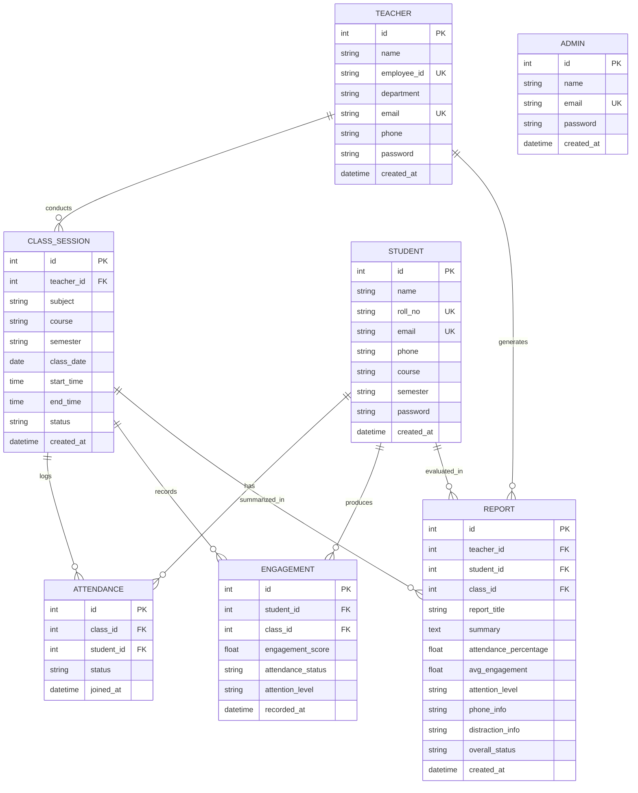
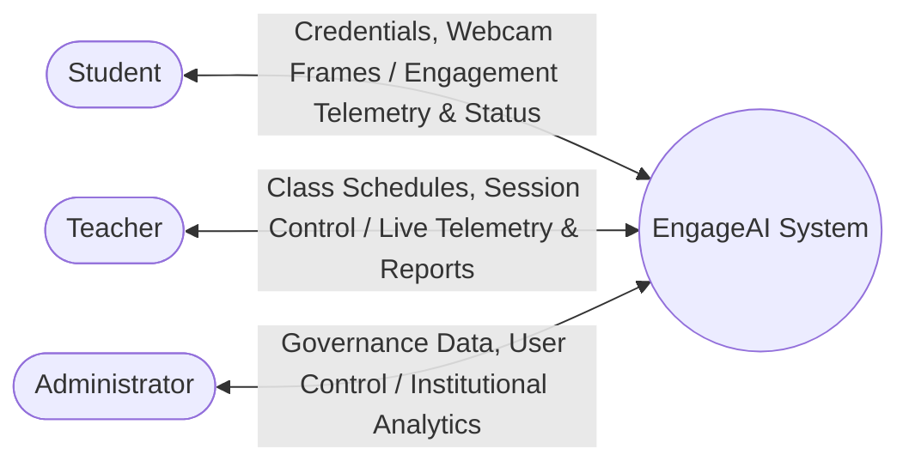
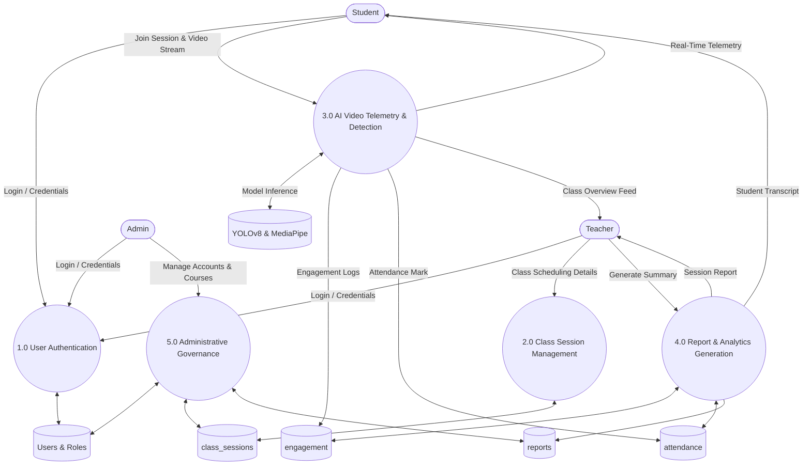
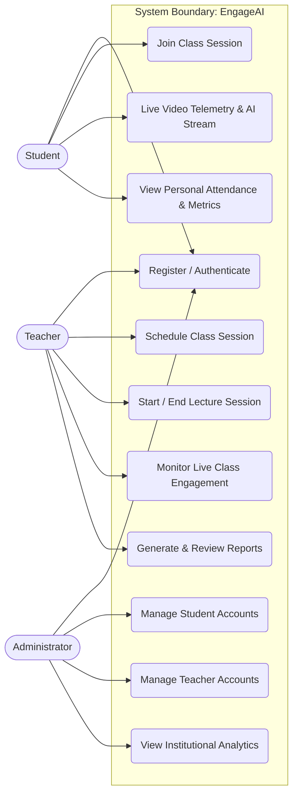
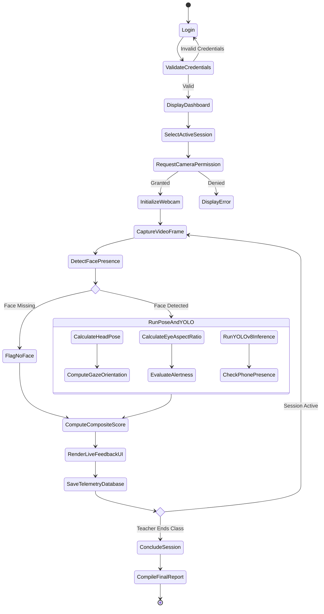
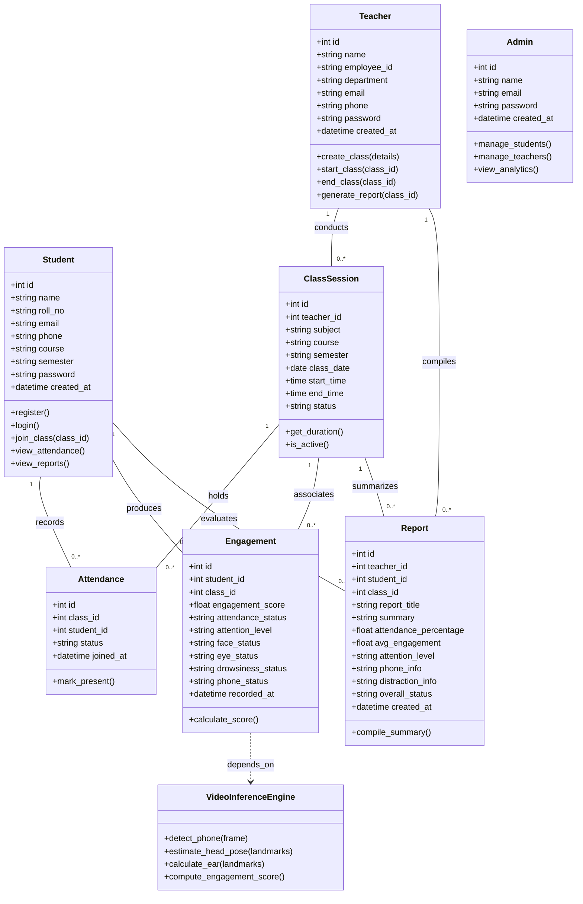
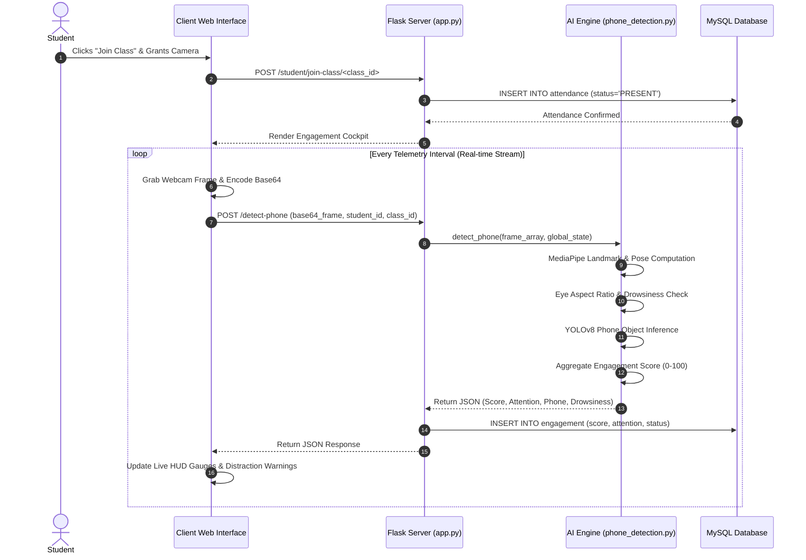
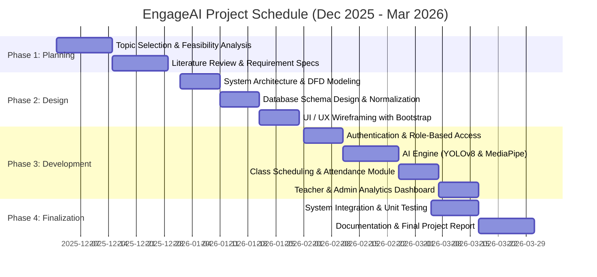
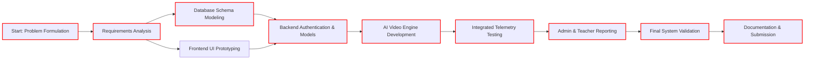
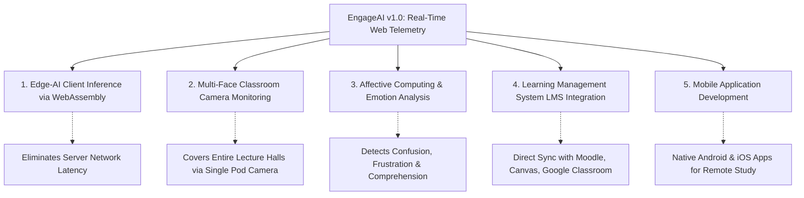

# A Project Report
## On
# “ENGAGEAI: AI-POWERED REAL-TIME STUDENT ENGAGEMENT AND ATTENDANCE MONITORING SYSTEM”

Submitted to the  
**Department of Computer Applications**  
*In partial fulfillment of the requirements for the award of the degree of*  
**MASTER OF COMPUTER APPLICATIONS**

Under the guidance of  
**Ms. VIDHYA V KUMAR**  
*Assistant Professor, Department of Computer Applications*

Project Done by  
**DIYA DEEPAK**  
Reg No: 2432422104XX

<br>

```
                  =============================================
                  MAR ATHANASIOS COLLEGE FOR ADVANCED STUDIES
                               TIRUVALLA (MACFAST)
                             689101, KERALA, INDIA
                               www.macfast.org
                  =============================================
                                  2024 - 2026
```

---

## MAR ATHANASIOS COLLEGE FOR ADVANCED STUDIES TIRUVALLA (MACFAST)
### DEPARTMENT OF COMPUTER APPLICATIONS

<br>

### BONAFIDE CERTIFICATE

Certified that the Project Work entitled **“ENGAGEAI: AI-POWERED REAL-TIME STUDENT ENGAGEMENT AND ATTENDANCE MONITORING SYSTEM”** is a Bonafide work done by **DIYA DEEPAK** in partial fulfillment of the requirement for the Award of **MASTER OF COMPUTER APPLICATIONS** Degree from **Mahatma Gandhi University, Kottayam** during the academic years 2024–2026.

<br>
<br>

**Mr. TIJI THOMAS**  
HEAD OF THE DEPARTMENT  

**Ms. VIDHYA V KUMAR**  
PROJECT GUIDE  

<br>

*Submitted for the Viva-voce Examination held on* ....................................

<br>

**External Examiner 1:** ....................................  
**External Examiner 2:** ....................................

---

## MAR ATHANASIOS COLLEGE FOR ADVANCED STUDIES TIRUVALLA (MACFAST)
### DEPARTMENT OF COMPUTER APPLICATIONS

<br>

### CERTIFICATE

This is to certify that the project **‘ENGAGEAI: AI-POWERED REAL-TIME STUDENT ENGAGEMENT AND ATTENDANCE MONITORING SYSTEM’** has been successfully carried out by **DIYA DEEPAK** (Reg No: 2432422104XX) in partial fulfillment of the course Master of Computer Applications.

<br>
<br>

**Ms. VIDHYA V KUMAR**  
INTERNAL GUIDE  

**Mr. TIJI THOMAS**  
HEAD OF THE DEPARTMENT  

**Date:** ....................

---

## MAR ATHANASIOS COLLEGE FOR ADVANCED STUDIES TIRUVALLA (MACFAST)
### DEPARTMENT OF COMPUTER APPLICATIONS

<br>

### CERTIFICATE

This is to certify that the project **‘ENGAGEAI: AI-POWERED REAL-TIME STUDENT ENGAGEMENT AND ATTENDANCE MONITORING SYSTEM’** has been successfully carried out by **DIYA DEEPAK** (Reg No: 2432422104XX) in partial fulfillment of the course Master of Computer Applications under my guidance.

<br>
<br>

**Ms. VIDHYA V KUMAR**  
INTERNAL GUIDE  

**Date:** ....................

---

## MAR ATHANASIOS COLLEGE FOR ADVANCED STUDIES TIRUVALLA (MACFAST)
### DEPARTMENT OF COMPUTER APPLICATIONS

<br>

### DECLARATION

I, **DIYA DEEPAK**, hereby declare that the project work entitled **“ENGAGEAI: AI-POWERED REAL-TIME STUDENT ENGAGEMENT AND ATTENDANCE MONITORING SYSTEM”** is an authenticated work carried out by me under the guidance of **Ms. VIDHYA V KUMAR** for the partial fulfillment of the course **MASTER OF COMPUTER APPLICATIONS**. This work has not been submitted for a similar purpose anywhere else except to **MAR ATHANASIOS COLLEGE FOR ADVANCED STUDIES TIRUVALLA (MACFAST)**. I understand that detection of any such copying is liable to be punished in any way the college deems fit.

<br>
<br>

**Date:**  
**Place:** Thiruvalla  
**DIYA DEEPAK**

---

## ACKNOWLEDGEMENT

First and foremost, let me thank the God Almighty for His immense grace and blessings at each and every stage of our project. I have exerted sincere efforts into this project; however, it would not have been possible without the kind support and guidance of many individuals and organizations.

I would like to extend my sincere gratitude to **Prof. Dr. Varghese K Cheriyan**, Principal, MACFAST, for liberally extending the valuable facilities of the college for our project completion and for his constant encouragement.

I express my deep gratitude to **Mr. Tiji Thomas**, Head of the Department of Computer Applications, for granting permission to undertake this project work and for his ongoing guidance.

I am highly indebted to **Ms. VIDHYA V KUMAR**, Assistant Professor, Department of Computer Applications, for her invaluable guidance, constant supervision, technical suggestions, and patient support throughout the development of this project.

I also extend my heartfelt appreciation to **Techmindz (Powered by Ndimensionz)**, Infopark Kochi, for providing an industry-oriented learning atmosphere and mentorship that elevated the standard of this endeavor.

I would like to express my love and gratitude towards my parents for their unwavering moral and financial support, cooperation, and encouragement, which served as my pillar of strength. Lastly, this project would not have reached fruition without the companionship and assistance of my fellow classmates and friends. I wholeheartedly thank each and every person who supported me throughout this journey.

<br>

**DIYA DEEPAK**

---

## TABLE OF CONTENTS

| SI NO | CONTENTS | CHAPTER / SECTION |
| :---: | :--- | :---: |
| **1** | **CHAPTER 1: INTRODUCTION** | **1.1 – 1.4** |
| | 1.1 Introduction | |
| | 1.2 Problem Statement | |
| | 1.3 Scope and Relevance of the Project | |
| | 1.4 Objectives | |
| **2** | **CHAPTER 2: SYSTEM ANALYSIS** | **2.1 – 2.5** |
| | 2.1 Introduction | |
| | 2.2 Existing System & Limitations | |
| | 2.3 Proposed System & Advantages | |
| | 2.4 Feasibility Study (Technical, Economic, Operational) | |
| | 2.5 Software Engineering Paradigm Applied | |
| **3** | **CHAPTER 3: SYSTEM DESIGN** | **3.1 – 3.7** |
| | 3.1 Introduction | |
| | 3.2 Database Design | |
| | &emsp; 3.2.1 Entity Relationship Model | |
| | &emsp; 3.2.2 Data Dictionary | |
| | 3.3 Process Design - Data Flow Diagram (DFD Levels 0, 1, 2) | |
| | 3.4 Object-Oriented Design - UML Diagrams | |
| | &emsp; 3.4.1 Use Case Diagram | |
| | &emsp; 3.4.2 Activity Diagram | |
| | &emsp; 3.4.3 Class Diagram | |
| | &emsp; 3.4.4 Sequence Diagram | |
| | 3.5 Modular Design & Structured Chart | |
| | 3.6 Input Design | |
| | 3.7 Output Design | |
| **4** | **CHAPTER 4: SYSTEM ENVIRONMENT** | **4.1 – 4.4** |
| | 4.1 Introduction | |
| | 4.2 Software Requirement Specification (SRS) | |
| | 4.3 Hardware Requirement Specification (HRS) | |
| | 4.4 Tools and Platforms (Frontend, Backend, OS) | |
| **5** | **CHAPTER 5: SYSTEM IMPLEMENTATION** | **5.1 – 5.4** |
| | 5.1 Introduction | |
| | 5.2 Coding & Coding Standards | |
| | &emsp; 5.2.1 Coding Standards | |
| | &emsp; 5.2.2 Sample Codes | |
| | &emsp; 5.2.3 Code Validation & Code Optimization | |
| | 5.3 Debugging | |
| | 5.4 Unit Testing & Test Cases | |
| **6** | **CHAPTER 6: SYSTEM PLANNING AND SCHEDULING** | **6.1 – 6.4** |
| | 6.1 Introduction | |
| | 6.2 Planning a Software Project | |
| | 6.3 Gantt Chart | |
| | 6.4 PERT Chart | |
| **7** | **CHAPTER 7: SYSTEM COST ESTIMATION** | **7.1 – 7.2** |
| | 7.1 Introduction | |
| | 7.2 Function Point Based Estimation | |
| **8** | **CHAPTER 8: SYSTEM TESTING** | **8.1 – 8.2** |
| | 8.1 Introduction | |
| | 8.2 Testing Procedures (Unit, Integration, Functional, UI, Performance, Security, UAT) | |
| **9** | **CHAPTER 9: SYSTEM MAINTENANCE** | **9.1 – 9.2** |
| | 9.1 Introduction | |
| | 9.2 Maintenance Strategies & Operational Procedures | |
| **10** | **CHAPTER 10: SYSTEM SECURITY MEASURES** | **10.1 – 10.4** |
| | 10.1 Introduction | |
| | 10.2 Operating System Level Security | |
| | 10.3 Database Level Security | |
| | 10.4 System & Application Level Security | |
| **11** | **CHAPTER 11: FUTURE ENHANCEMENT** | **11.1 – 11.4** |
| | 11.1 Introduction | |
| | 11.2 Limitations of the System | |
| | 11.3 Merits of the System | |
| | 11.4 Future Enhancement Roadmap | |
| **12** | **CHAPTER 12: CONCLUSION** | **12.1** |
| **13** | **CHAPTER 13: ANNEXURE** | **13.1 – 13.3** |
| | 13.1 Organization Profile | |
| | 13.2 System Screenshots & Interface Descriptions | |
| | 13.3 References | |

---

# ABSTRACT

The **EngageAI: AI-Powered Real-Time Student Engagement and Attendance Monitoring System** transforms conventional educational monitoring and modernizes classroom management through non-intrusive artificial intelligence and computer vision technologies. Modern education increasingly relies on hybrid, digital, and large-scale classroom environments where educators face severe challenges in gauging student attentiveness, managing timely attendance, and identifying early disengagement or academic fatigue. EngageAI bridges this critical operational and pedagogical gap by providing an automated, real-time web platform engineered using Python, the Flask micro-framework, OpenCV, MediaPipe Face Landmarker, and Ultralytics YOLOv8.

From the student’s perspective, the system provides a seamless digital portal where learners register, authenticate, join active class sessions, and engage in study with continuous, non-invasive feedback. Through camera streaming, the AI pipeline executes multi-attribute telemetry—detecting face presence, computing head pose (yaw, pitch, roll) to identify orientation (looking straight vs. looking away), measuring Eye Aspect Ratio (EAR) to detect drowsiness and closed eyes, and deploying YOLOv8 object detection to identify unauthorized mobile phone usage in real time. These metrics are dynamically aggregated into an objective Engagement Score (0%–100%) and categorised into attention states (High, Medium, Low).

From the instructor and administrative perspectives, EngageAI replaces unreliable manual roll calls and subjective observation. Teachers can schedule lecture sessions, initialize live monitoring, inspect real-time engagement telemetry, record attendance upon verification, and generate automated comprehensive performance reports. Administrators possess global management privileges to oversee student directories, faculty allocations, course schedules, and institution-wide analytics. Built on a robust relational database with MySQL, EngageAI delivers audit trails, minimizes administrative overhead, and provides empirical, data-driven insights into classroom attentiveness. The project demonstrates how ethical computer vision and web engineering can elevate academic accountability and improve learning outcomes.

---

# CHAPTER 1: INTRODUCTION

### 1.1 INTRODUCTION
In today's rapidly evolving educational landscape, digital transformation has fundamentally reshaped teaching and learning methodologies. From traditional physical lecture halls to modern smart classrooms and hybrid e-learning environments, academic institutions are continuously seeking intelligent solutions to elevate educational quality and operational efficiency. One of the most decisive indicators of learning effectiveness and academic success is student engagement. However, systematically measuring student attention, maintaining accurate attendance records, and detecting distractions have traditionally remained labor-intensive, error-prone, and subjective tasks.

To confront these persistent challenges, **EngageAI: AI-Powered Real-Time Student Engagement and Attendance Monitoring System** has been developed as an intelligent, scalable, and cross-platform web application. Built with Python, Flask, OpenCV, MediaPipe Face Landmarker, and Ultralytics YOLOv8, EngageAI establishes an automated bridge between classroom instruction and actionable behavioural telemetry. The system automatically verifies student presence, streams video frames securely, and applies state-of-the-art computer vision models to evaluate head pose orientation, eye gaze openness, drowsiness indicators, and unauthorized mobile phone usage during class sessions.

Beyond empowering students with real-time feedback regarding their study habits and focus levels, the application equips educators with an interactive cockpit. Teachers can schedule course sessions, monitor student engagement in real time, view automated roll calls, and generate consolidated performance reports with empirical metrics. Administrators gain complete visibility over institutional statistics, ensuring accountability across departments, faculty, and student cohorts. By replacing antiquated manual ledgers with an intelligent digital infrastructure, EngageAI enhances classroom productivity, fosters student self-regulation, and provides empirical data for data-driven academic governance.

---

### 1.2 PROBLEM STATEMENT
The conventional approach to monitoring student attendance and engagement in schools, colleges, and university lecture halls suffers from profound inefficiencies, inaccuracies, and human limitations:

1. **Time-Consuming Roll Calls:** Instructors spend between 10% and 20% of valuable lecture time manually calling out roll numbers or circulating paper attendance sheets, which diminishes teaching duration and disrupts lecture continuity.
2. **Proxy Attendance and Falsification:** Paper ledgers and manual verification are vulnerable to proxy attendance, unauthorized sign-ins, and retroactive falsification, degrading the integrity of institutional records.
3. **Inability to Measure Cognitive Engagement:** Physical presence does not equate to active cognitive participation. In large classrooms of 60 to 120 students, a teacher cannot simultaneously track which students are zoned out, experiencing drowsiness, or looking away from the lecture board.
4. **Distraction by Mobile Devices:** Unchecked smartphone utilization during academic hours has become an endemic source of academic distraction. Instructors cannot constantly patrol lecture halls to spot concealed mobile phones without interrupting class delivery.
5. **Absence of Empirical Data for Intervention:** Traditional assessment methods only detect student disengagement after poor examination performance or mid-term failures occur. Educational institutions lack continuous, real-time analytics to identify at-risk students beforehand and administer proactive academic counselling.

---

### 1.3 SCOPE AND RELEVANCE OF THE PROJECT

#### SCOPE
The scope of the EngageAI platform encompasses a comprehensive, role-based web and computer vision architecture tailored for modern higher education institutions:

* **Student-Facing Scope:** Allows students to securely register, manage academic profiles, join active lecture sessions, receive real-time AI-based visual telemetry (gaze alignment, alertness status, mobile phone alerts), and track their cumulative attendance and engagement trends.
* **Faculty/Teacher Scope:** Equips educators to schedule class sessions, initiate and terminate live lecture streams, monitor aggregated classroom engagement in real time, record automated attendance, and automatically generate comprehensive class performance summaries.
* **Administrative Scope:** Empowers academic administrators to manage student records, faculty rosters, course allocations, institutional settings, and aggregate multi-departmental engagement analytics.
* **Computer Vision and AI Scope:** Executes lightweight, edge-compatible computer vision algorithms directly within the application pipeline, combining YOLOv8 for object recognition (cell phone detection), MediaPipe Face Landmarker for 3D head pose and landmark tracking, and OpenCV for image pre-processing and Eye Aspect Ratio (EAR) calculation.

#### RELEVANCE
* **Pedagogical Impact:** Provides continuous, non-punitive behavioural feedback that encourages self-regulation and deeper learning engagement among students.
* **Operational Efficiency:** Eliminates repetitive attendance overhead for faculty, recovering substantial lecture time for active discussion and conceptual instruction.
* **Data-Driven Academic Governance:** Provides department heads and academic deans with empirical analytics to evaluate curriculum engagement, lecture timing efficacy, and student retention strategies.
* **Scalable and Cost-Effective:** Leveraging open-source frameworks (Flask, OpenCV, YOLOv8) and consumer-grade web cameras, EngageAI eliminates the necessity for prohibitive hardware investments.

---

### 1.4 OBJECTIVES
The central goal of EngageAI is to modernize academic monitoring through non-intrusive, intelligent computer vision. The project accomplishes this via the following key objectives:

1. **Delivering an Automated Attendance Workflow:** To replace manual paper roll calls with an automated digital verification mechanism linked directly to active class session participation.
2. **Developing Real-Time Computer Vision Engagement Telemetry:** To deploy computer vision algorithms capable of detecting face presence, head pose orientation (looking straight vs. looking away), and eye openness in real time.
3. **Automating Detection of Digital Distractions:** To integrate YOLOv8 deep learning models for detecting unauthorized mobile phone usage during academic lecture hours.
4. **Quantifying Attention into an Empirical Score:** To calculate an algorithmic Engagement Score (0%–100%) that weights alertness, gaze focus, and distraction indicators into an interpretable metric.
5. **Providing Role-Based Interactive Dashboards:** To implement secure role-based portals for Students, Teachers, and Administrators ensuring granular access control and tailored functionality.
6. **Generating Actionable Academic Analytics:** To furnish instructors with automated analytical reports detailing student attendance percentages, average attention levels, and distraction summaries.
7. **Ensuring Data Security and User Privacy:** To enforce secure credential hashing, session isolation, and non-persistent frame processing to uphold student data privacy.

---

# CHAPTER 2: SYSTEM ANALYSIS

### 2.1 INTRODUCTION
System analysis is a foundational phase in the software development lifecycle that investigates current operational practices, diagnoses intrinsic shortcomings, and formulates functional and non-functional specifications for the proposed system. It systematically examines how current workflows operate in academic institutions, establishes user requirements across diverse stakeholder groups, and specifies how cutting-edge computer vision and web engineering can resolve existing inefficiencies.

In conventional classroom settings, instructors evaluate student attentiveness purely through visual observation while delivering lecture material. This manual method suffers from cognitive fatigue, human bias, and physical impossibility when dealing with large classrooms. EngageAI replaces subjective observation with automated digital telemetry, establishing a transparent, scalable, and auditable foundation for classroom analytics.

---

### 2.2 EXISTING SYSTEM
The existing classroom attendance and engagement management workflow depends heavily on manual human intervention:
* Attendance is recorded using physical paper registers, roll call sheets, or rudimentary static digital spreadsheets.
* Gauging student attention relies on the teacher's subjective observation from the podium.
* Identification of distractions—such as concealed mobile phone texting or drowsiness—requires active patrolling by the instructor.
* Academic feedback on disengagement is solely retroactive, typically recognized after low test scores or high absenteeism rates at the end of the academic semester.

#### LIMITATIONS OF EXISTING SYSTEM
* **Vulnerability to Proxy Attendance:** Paper-based sign-in sheets and casual roll calls allow peers to mark attendance for absent classmates.
* **Severe Loss of Lecture Time:** Calling out 60 to 100 student roll numbers consumes up to 15 minutes per lecture period.
* **Subjective and Unrecorded Attentiveness:** An instructor cannot objectively track which students remained attentive throughout a 60-minute technical lecture.
* **Unmonitored Digital Distractions:** Widespread access to smartphones enables covert texting and social media browsing behind laptop screens or lecture desks.
* **Absence of Historical Telemetry:** Institutions possess no longitudinal data explaining why certain students drop performance in specific subjects.
* **Data Loss and Record Degradation:** Physical attendance books are prone to damage, misplacement, and transcription errors.

---

### 2.3 PROPOSED SYSTEM
The proposed **EngageAI** system is a web-based, AI-driven platform that automates attendance recording and tracks cognitive engagement in real time. Students log into their secure portal and connect their standard web camera during active class sessions. The AI engine processes live video frames, running inference on lightweight deep learning models to assess attention, drowsiness, and unauthorized device usage.

Instructors initiate scheduled sessions, monitor real-time engagement telemetry via clean visual graphs, and generate detailed student summaries upon lecture completion. Administrators maintain overarching governance over institutional data, users, and courses.

#### ADVANTAGES OF PROPOSED SYSTEM
* **Instantaneous Automated Attendance:** Automatically records presence upon verified session participation, eliminating manual roll call overhead.
* **Real-Time Distraction and Drowsiness Detection:** Flags mobile phone usage, looking away, and prolonged eye closure (drowsiness) immediately.
* **Empirical Engagement Scoring:** Converts raw facial landmarks and bounding boxes into an objective 0%–100% Engagement Score.
* **Privacy-Conscious Architecture:** Video streams are analyzed frame-by-frame in memory without storing raw video recordings on disk, ensuring student privacy.
* **Granular Role-Based Access Control:** Strict segregation of privileges between Students, Teachers, and Administrators.
* **Comprehensive Performance Reporting:** Equips faculty with downloadable summary reports detailing engagement averages, distraction counts, and attendance rates.

---

### 2.4 FEASIBILITY STUDY
A feasibility study evaluates whether the proposed project is practical, cost-effective, and beneficial within technical, economic, and operational boundaries.

```
                  +----------------------------------------------+
                  |              FEASIBILITY STUDY               |
                  +----------------------+-----------------------+
                                         |
         +-------------------------------+-------------------------------+
         |                               |                               |
+-----------------+             +-----------------+             +-----------------+
|    TECHNICAL    |             |    ECONOMIC     |             |   OPERATIONAL   |
|   FEASIBILITY   |             |   FEASIBILITY   |             |   FEASIBILITY   |
+-----------------+             +-----------------+             +-----------------+
| • Python & Flask|             | • Free Open-    |             | • Intuitive UI  |
| • OpenCV & YOLO |             |   Source Stack  |             | • Role-based    |
| • MediaPipe     |             | • Zero License  |             |   Dashboards    |
| • Standard Webcams            |   Cost          |             | • High Faculty  |
| • MySQL Database              | • Low Hardware  |             |   Acceptance    |
+-----------------+             +-----------------+             +-----------------+
```

#### TECHNICAL FEASIBILITY
Technical feasibility evaluates the availability of programming frameworks, machine learning models, and system hardware needed to execute the software.
* **Core Technologies:** EngageAI is built with Python 3.10+, Flask, OpenCV, MediaPipe, Ultralytics YOLOv8, and MySQL. All libraries are mature, stable, thoroughly documented, and widely supported.
* **Model Efficiency:** `yolov8n.pt` (nano) and `face_landmarker.task` are optimized for low-latency inference on standard consumer CPU and GPU configurations, ensuring real-time responsiveness (15–30 FPS).
* **Hardware Requirements:** Standard desktop/laptop webcams and institutional PCs satisfy all execution requirements without requiring specialized enterprise AI hardware.
* **Conclusion:** The project is technically feasible.

#### ECONOMIC FEASIBILITY
Economic feasibility assesses the financial expenditure required for system design, deployment, and operational maintenance versus the anticipated benefits.
* **Zero Software Licensing Cost:** All underlying frameworks (Python, Flask, OpenCV, MediaPipe, YOLOv8, MySQL, Bootstrap) are open-source and free for educational use.
* **Minimal Infrastructure Overhead:** The system functions on existing institutional computer laboratories and student laptops without requiring expensive biometric hardware scanners.
* **Substantial Time and Resource Savings:** Saves hundreds of teaching hours per semester previously wasted on manual roll calls and reduces administrative paper expenses.
* **Conclusion:** The project is economically feasible and cost-effective.

#### OPERATIONAL FEASIBILITY
Operational feasibility determines how smoothly the solution integrates into real-world academic workflows and whether users will adopt it comfortably.
* **User-Centric Design:** Simple, responsive web interfaces allow students and faculty of all technical proficiency levels to navigate sessions effortlessly.
* **Zero Disruption to Pedagogy:** Faculty members can teach without altering their lecturing style, while the system silently evaluates engagement in the background.
* **Transparency:** Clear dashboards and real-time status indicators ensure trust and clarity for students regarding how their engagement score is calculated.
* **Conclusion:** The project is operationally feasible and beneficial.

---

### 2.5 SOFTWARE ENGINEERING PARADIGM APPLIED
For the development of EngageAI, the **Waterfall Model of the Software Development Life Cycle (SDLC)** was chosen. The Waterfall Model is a sequential, milestone-driven software engineering paradigm where each phase must be thoroughly analyzed, documented, and verified before advancing to the subsequent stage. This structured paradigm ensures comprehensive requirement definition, rigorous database schema formulation, and thorough testing.

```
[ Phase 1: Requirement Analysis ]
              |
              v
     [ Phase 2: System Design ]
              |
              v
     [ Phase 3: Implementation & Coding ]
              |
              v
     [ Phase 4: Integration & Testing ]
              |
              v
     [ Phase 5: Deployment & Maintenance ]
```

1. **Requirement Analysis:** Comprehensive identification of stakeholder needs across Students, Teachers, and Administrators. Functional specifications for real-time video telemetry, head pose estimation, phone detection, and automated attendance were documented.
2. **System Design:** Architectural modeling of the application, including the MySQL database schema (7 core tables), Entity-Relationship (ER) models, Data Flow Diagrams (DFDs), and UML design (Use Case, Activity, Class, and Sequence diagrams).
3. **Implementation & Coding:** Modular development of the Python backend using Flask, building computer vision pipelines with MediaPipe and YOLOv8, and coding responsive frontend interfaces using Bootstrap 5 and Jinja2 templates.
4. **Integration & Testing:** Rigorous unit testing of AI inference models, session management, and database queries, followed by black-box and integration testing across client-server interactions.
5. **Deployment & Maintenance:** Local deployment on web servers, performance monitoring, database optimization, and documentation of future enhancement roadmaps.

---

# CHAPTER 3: SYSTEM DESIGN

### 3.1 INTRODUCTION
System design translates software requirements into a coherent technical architecture. EngageAI follows a modular **Client-Server Architecture** adhering to the **Model-View-Controller (MVC) / Model-Template-View (MTV)** pattern via Flask. 

* The **Frontend** presents responsive, intuitive web interfaces rendered with HTML5, CSS3, JavaScript (ES6+), Bootstrap 5, and Jinja2 templates.
* The **Backend** server processes HTTP requests, enforces business rules, handles session cookies, executes computer vision inference algorithms, and interacts with MySQL through Flask-SQLAlchemy and Flask-MySQLdb.
* The **Database** layer guarantees persistent, normalized storage for user credentials, class sessions, attendance logs, engagement metrics, and analytical reports.

The system incorporates three distinct actors:
1. **Student:** Joins scheduled sessions, streams camera frames, receives real-time engagement telemetry, and views attendance records.
2. **Teacher:** Creates class schedules, initiates/terminates live sessions, monitors aggregated student engagement, and compiles academic reports.
3. **Administrator:** Governs institution-wide accounts, audits system logs, and oversees departmental analytics.

---

### 3.2 DATABASE DESIGN

#### 3.2.1 ENTITY RELATIONSHIP MODEL
The Entity-Relationship (ER) model graphically articulates the conceptual schema of the database, specifying entities, primary keys, foreign key associations, and cardinalities.

* **Entities:** Student, Teacher, Admin, ClassSession, Attendance, Engagement, Report.
* **Key Relationships:**
  * One Teacher conducts **Many** ClassSessions ($1:N$).
  * One ClassSession involves **Many** Attendances ($1:N$) and **Many** Engagements ($1:N$).
  * One Student has **Many** Attendances ($1:N$) and **Many** Engagements ($1:N$).
  * A Student and ClassSession pair yields an **Attendance** record ($1:1$ unique constraint).
  * A Teacher, Student, and ClassSession generate a **Report** ($1:1$ unique per student-class session).



---

#### 3.2.2 DATA DICTIONARY
The data dictionary details the physical schema, specifying field names, data types, lengths, constraints, and operational descriptions for every table in the `engageai` database.

#### Table 1: students
| FIELDNAME | DATA TYPE | SIZE | CONSTRAINTS | DESCRIPTION |
| :--- | :--- | :---: | :--- | :--- |
| `id` | INT | - | Primary Key, Auto-Increment | Unique identifier for each student |
| `name` | VARCHAR | 100 | NOT NULL | Full name of the student |
| `roll_no` | VARCHAR | 50 | NOT NULL, UNIQUE | Institutional roll/registration number |
| `email` | VARCHAR | 100 | NOT NULL, UNIQUE | University email for login and alerts |
| `phone` | VARCHAR | 20 | NOT NULL | Contact telephone number |
| `course` | VARCHAR | 100 | NOT NULL | Academic program (e.g., MCA, B.Tech) |
| `semester` | VARCHAR | 20 | NOT NULL | Current enrolled semester |
| `password` | VARCHAR | 255 | NOT NULL | Hashed account password |
| `created_at` | TIMESTAMP | - | DEFAULT CURRENT_TIMESTAMP | Account creation timestamp |

#### Table 2: teachers
| FIELDNAME | DATA TYPE | SIZE | CONSTRAINTS | DESCRIPTION |
| :--- | :--- | :---: | :--- | :--- |
| `id` | INT | - | Primary Key, Auto-Increment | Unique identifier for each faculty member |
| `name` | VARCHAR | 100 | NOT NULL | Full name of the teacher |
| `employee_id` | VARCHAR | 50 | NOT NULL, UNIQUE | Official institutional employee code |
| `department` | VARCHAR | 100 | NOT NULL | Academic department (e.g., Computer Applications) |
| `email` | VARCHAR | 100 | NOT NULL, UNIQUE | Faculty official email address |
| `phone` | VARCHAR | 20 | NOT NULL | Contact telephone number |
| `password` | VARCHAR | 255 | NOT NULL | Hashed account password |
| `created_at` | TIMESTAMP | - | DEFAULT CURRENT_TIMESTAMP | Account creation timestamp |

#### Table 3: admins
| FIELDNAME | DATA TYPE | SIZE | CONSTRAINTS | DESCRIPTION |
| :--- | :--- | :---: | :--- | :--- |
| `id` | INT | - | Primary Key, Auto-Increment | Unique identifier for the administrator |
| `name` | VARCHAR | 100 | NULL | Administrator display name |
| `email` | VARCHAR | 100 | NOT NULL, UNIQUE | Official administrative email for system login |
| `password` | VARCHAR | 255 | NOT NULL | Hashed administrative password |
| `created_at` | TIMESTAMP | - | DEFAULT CURRENT_TIMESTAMP | Administrator registration timestamp |

#### Table 4: class_sessions
| FIELDNAME | DATA TYPE | SIZE | CONSTRAINTS | DESCRIPTION |
| :--- | :--- | :---: | :--- | :--- |
| `id` | INT | - | Primary Key, Auto-Increment | Unique identifier for the class session |
| `teacher_id` | INT | - | Foreign Key (teachers.id) ON DELETE CASCADE | ID of the faculty conducting the lecture |
| `subject` | VARCHAR | 100 | NOT NULL | Course subject name |
| `course` | VARCHAR | 100 | NOT NULL | Academic degree program |
| `semester` | VARCHAR | 20 | NOT NULL | Target semester |
| `class_date` | DATE | - | NOT NULL | Scheduled calendar date of lecture |
| `start_time` | TIME | - | NOT NULL | Scheduled commencement time |
| `end_time` | TIME | - | NOT NULL | Scheduled concluding time |
| `status` | VARCHAR | 20 | NOT NULL, DEFAULT 'Scheduled' | State: Scheduled, Active, or Completed |
| `created_at` | TIMESTAMP | - | DEFAULT CURRENT_TIMESTAMP | Session record creation timestamp |

#### Table 5: attendance
| FIELDNAME | DATA TYPE | SIZE | CONSTRAINTS | DESCRIPTION |
| :--- | :--- | :---: | :--- | :--- |
| `id` | INT | - | Primary Key, Auto-Increment | Unique attendance record identifier |
| `class_id` | INT | - | Foreign Key (class_sessions.id) ON DELETE CASCADE | Reference to the attended class session |
| `student_id` | INT | - | Foreign Key (students.id) ON DELETE CASCADE | Reference to the verified student |
| `status` | VARCHAR | 20 | NOT NULL, DEFAULT 'PRESENT' | Attendance status: PRESENT or ABSENT |
| `joined_at` | TIMESTAMP | - | DEFAULT CURRENT_TIMESTAMP | Exact timestamp when student entered session |
| *Constraint* | UNIQUE KEY | - | `unique_class_student` (`class_id`, `student_id`) | Prevents duplicate attendance entries |

#### Table 6: engagement
| FIELDNAME | DATA TYPE | SIZE | CONSTRAINTS | DESCRIPTION |
| :--- | :--- | :---: | :--- | :--- |
| `id` | INT | - | Primary Key, Auto-Increment | Unique telemetry log identifier |
| `student_id` | INT | - | Foreign Key (students.id) ON DELETE CASCADE | Reference to monitored student |
| `class_id` | INT | - | Foreign Key (class_sessions.id) ON DELETE SET NULL | Reference to active class session |
| `engagement_score` | FLOAT | - | NOT NULL | Calculated attention score (0.0 – 100.0) |
| `attendance_status` | VARCHAR | 20 | NOT NULL, DEFAULT 'Present' | In-session participation flag |
| `attention_level` | VARCHAR | 50 | NULL | High, Medium, or Low attention tier |
| `recorded_at` | TIMESTAMP | - | DEFAULT CURRENT_TIMESTAMP | Frame inference timestamp |

#### Table 7: reports
| FIELDNAME | DATA TYPE | SIZE | CONSTRAINTS | DESCRIPTION |
| :--- | :--- | :---: | :--- | :--- |
| `id` | INT | - | Primary Key, Auto-Increment | Unique report identifier |
| `teacher_id` | INT | - | Foreign Key (teachers.id) ON DELETE CASCADE | Faculty who compiled the report |
| `student_id` | INT | - | Foreign Key (students.id) ON DELETE CASCADE | Evaluated student |
| `class_id` | INT | - | Foreign Key (class_sessions.id) ON DELETE CASCADE | Evaluated lecture session |
| `report_title` | VARCHAR | 255 | NOT NULL | Descriptive header of report |
| `summary` | TEXT | - | NOT NULL | Textual summary and AI remarks |
| `attendance_percentage` | FLOAT | - | DEFAULT 0.0 | Cumulative student attendance metric |
| `avg_engagement` | FLOAT | - | DEFAULT 0.0 | Mean engagement score during class |
| `attention_level` | VARCHAR | 50 | NULL | Predominant focus tier |
| `phone_info` | VARCHAR | 100 | NULL | Count/Duration of mobile phone detections |
| `distraction_info` | VARCHAR | 100 | NULL | Looking away or drowsiness records |
| `overall_status` | VARCHAR | 50 | NULL | Final assessment (e.g., Attentive, Needs Focus) |
| `created_at` | TIMESTAMP | - | DEFAULT CURRENT_TIMESTAMP | Report generation timestamp |
| *Constraint* | UNIQUE KEY | - | `unique_student_class_report` (`student_id`, `class_id`) | Ensures singular report per student-session |

---

### 3.3 PROCESS DESIGN - DATA FLOW DIAGRAM

A Data Flow Diagram (DFD) graphically traces how data moves through business processes, transitions through logical processing nodes, and is stored in data repositories.

* **External Entities:** Student, Teacher, Admin.
* **Processes:** Circular transforms converting input data into structured intelligence.
* **Data Stores:** Parallel lines representing persistent relational tables.
* **Data Flows:** Directed arrows illustrating data transit.

#### Level 0 DFD (Context Diagram)
The Level 0 DFD portrays EngageAI as a single consolidated process interacting with its external human stakeholders.



---

#### Level 1 DFD
The Level 1 DFD decomposes the system into its major core subsystems.



---

#### Level 2 DFD: AI Video Telemetry Subsystem
The Level 2 DFD details the internal data mechanics of process 3.0 (AI Telemetry and Engagement Scoring).

```mermaid
flowchart TD
    FrameInput[Client Video Frame (Base64 JPEG)] --> P31((3.1 Frame Decoding & Preprocessing))
    P31 --> FrameRGB[RGB / Grayscale Image Array]

    FrameRGB --> P32((3.2 YOLOv8 Object Detection))
    P32 -->|Cell Phone Bounding Box| PhoneDecision{Phone Detected?}
    PhoneDecision -- Yes --> ScorePenalty1[Deduct Engagement Points]
    PhoneDecision -- No --> ClearPhone[Status: No Phone]

    FrameRGB --> P33((3.3 MediaPipe Face Landmarker))
    P33 -->|3D Facial Mesh & Matrix| PoseCalc((3.4 Head Pose Euler Angles))
    PoseCalc --> Orientation{Yaw / Pitch / Roll Bounds}
    Orientation -- Center --> Straight[Looking Straight]
    Orientation -- Out of Bounds --> LookAway[Looking Away: Deduct Points]

    P33 -->|Eye Landmarks| EARCalc((3.5 Eye Aspect Ratio Calculation))
    EARCalc --> DrowsyCheck{EAR < Threshold for N Frames?}
    DrowsyCheck -- Yes --> DrowsyAlert[Flag: Drowsiness Alert]
    DrowsyCheck -- No --> AlertEyes[Eyes Alert on Screen]

    ScorePenalty1 --> P36((3.6 Composite Score Engine))
    ClearPhone --> P36
    Straight --> P36
    LookAway --> P36
    DrowsyAlert --> P36
    AlertEyes --> P36

    P36 --> OutputJSON[Calculated Engagement Score (0-100%) & Status JSON]
    OutputJSON --> TelemetryDB[(engagement Table)]
    OutputJSON --> ClientSocket[Return Real-Time Dashboard Feedback]
```

---

### 3.4 OBJECT ORIENTED DESIGN - UML DIAGRAMS

#### 3.4.1 USE CASE DIAGRAM
The Use Case Diagram defines the functional scope of EngageAI from the vantage point of each actor:

* **Student:** Register Account, Login, View Dashboard, Join Live Class Session, Stream Webcam for Engagement, View Personal Attendance, View Engagement History.
* **Teacher:** Login, Schedule Class Session, Start/End Live Lecture, View Real-time Student Telemetry, Generate Performance Report, Export Attendance.
* **Admin:** Secure Admin Login, Manage Student Accounts, Manage Faculty Accounts, View Institutional Analytics, Configure System Parameters.



---

#### 3.4.2 ACTIVITY DIAGRAM
The Activity Diagram models the dynamic operational control flow of a student participating in an AI-monitored lecture session.



---

#### 3.4.3 CLASS DIAGRAM
The Class Diagram visualizes the object-oriented structure, representing classes, attributes, methods, and relationships.



---

#### 3.4.4 SEQUENCE DIAGRAM
The Sequence Diagram details chronological message passing between system lifelines during a live class telemetry iteration.



---

### 3.5 MODULAR DESIGN & STRUCTURED CHART

Modular design divides complex software into decoupled, maintainable, and independently testable modules. 

```
                               +---------------------------------------------+
                               |                  LEVEL 0:                   |
                               |    EngageAI Core System Controller          |
                               +----------------------+----------------------+
                                                      |
         +--------------------+-----------------------+-----------------------+--------------------+
         |                    |                       |                       |                    |
+--------+--------+  +--------+--------+     +--------+--------+     +--------+--------+  +--------+--------+
|    MODULE 1:    |  |    MODULE 2:    |     |    MODULE 3:    |     |    MODULE 4:    |  |    MODULE 5:    |
| User Management |  |  Class Session  |     |   Real-Time AI  |     |   Attendance    |  |  Reporting &    |
| & Authentication|  |   Management    |     |    Telemetry    |     |    Tracking     |  | Administrative  |
+-----------------+  +-----------------+     +-----------------+     +-----------------+  +-----------------+
| • Registration  |  | • Schedule Class|     | • YOLOv8 Phone  |     | • Join Session  |  | • Analytics     |
| • PBKDF2 Login  |  | • Start / End   |     | • MediaPipe Pose|     | • Anti-proxy    |  | • Student Mgmt  |
| • RBAC Guard    |  | • Active Roster |     | • EAR Drowsiness|     | • Attendance Log|  | • Teacher Mgmt  |
| • Session State |  | • Subject Filter|     | • Score Compute |     | • Date Sorting  |  | • Export Data   |
+-----------------+  +-----------------+     +-----------------+     +-----------------+  +-----------------+
```

#### MODULE DESCRIPTIONS

1. **User Management and Authentication Module (`User_Master`):**
   * Handles user onboarding for Students and Teachers with strict regex validation (email, 10-digit phone, employee ID, roll number).
   * Manages encrypted password hashing using PBKDF2/SHA256 and maintains authenticated Flask session contexts.
   * Enforces Role-Based Access Control (RBAC), redirecting users to their respective portals (Student, Teacher, or Admin).

2. **Class Session Management Module (`Class_Master`):**
   * Allows instructors to create, schedule, filter, and monitor course sessions.
   * Manages class lifecycle states (`Scheduled` $\rightarrow$ `Active` $\rightarrow$ `Completed`).
   * Couples students to subject sessions by matching academic course and semester attributes.

3. **Real-Time AI Telemetry and Engagement Module (`AI_Engine`):**
   * Receives decoded video frames and performs lightweight, multi-threaded computer vision inference.
   * Employs MediaPipe Face Landmarker for 3D face mesh extraction and Euler angle calculation (Yaw, Pitch, Roll) to determine head gaze.
   * Calculates Eye Aspect Ratio (EAR) across consecutive frames to detect drowsiness and prolonged eye closure.
   * Executes Ultralytics YOLOv8 inference to detect handheld cell phone bounding boxes.
   * Synthesizes telemetry into a calibrated 0%–100% composite Engagement Score.

4. **Attendance Tracking Module (`Attendance_Master`):**
   * Automatically marks students present upon session entry with a timestamp.
   * Enforces a database composite unique constraint (`class_id`, `student_id`) to prevent duplicate attendance logs.
   * Supplies historical attendance metrics to faculty and student profile views.

5. **Analytical Reporting and Administrative Governance Module (`Admin_Reports`):**
   * Aggregates session-level engagement logs into longitudinal averages, focus tiers, and distraction frequencies.
   * Provides administrators with global CRUD controls over faculty, student rosters, and institutional settings.

---

### 3.6 INPUT DESIGN
Input design standardizes data acquisition to ensure data integrity, prevent injection vectors, and optimize usability:

* **Student Registration Form:** Standardized inputs for Name, Roll No (alphanumeric regex `^[a-zA-Z0-9\-\/]{3,20}$`), Email (`^[a-zA-Z0-9._%+-]+@[a-zA-Z0-9.-]+\.[a-zA-Z]{2,}$`), Phone (10 digits), Course dropdown, and Semester dropdown.
* **Faculty Registration Form:** Captures Employee ID, Department, Email, Phone, and Password credentials.
* **Class Scheduling Modal:** Structured date picker (`YYYY-MM-DD`), start/end time selectors with time-zone parsing (IST UTC+5:30), course and semester drop-downs.
* **Live Video Capture Stream:** Client-side HTML5 canvas capture serializing webcam frames to Base64-encoded JPEG strings for transmission to `/detect-phone`.
* **Validation Architecture:** Dual-layer validation comprising client-side HTML5 constraints and server-side Python regex parsing prior to database execution.

---

### 3.7 OUTPUT DESIGN
Output design focuses on presenting actionable, well-organized feedback to users:

* **Student Engagement Cockpit:** Displays a live video preview overlayed with real-time telemetry indicators:
  * Attention status badge (e.g., "LOOKING STRAIGHT" vs. "LOOKING AWAY").
  * Alertness pill ("ALERT" vs. "DROWSY DETECTED").
  * Distraction alert ("NO PHONE DETECTED" vs. "PHONE DETECTED").
  * Dynamic radial gauge displaying the composite Engagement Score (0%–100%).
* **Teacher Live Session Dashboard:** Shows active class enrollment numbers, real-time classroom average engagement meters, and real-time alerts.
* **Student Academic Report:** Consolidated report presenting cumulative attendance percentage, mean engagement rating, phone infraction counts, and personalized instructor recommendations.
* **Admin Executive Dashboard:** Visual representation of total students, registered teachers, active class counts, and historical engagement distribution across academic departments.

#### DESIGN PRINCIPLES FOLLOWED
1. **Consistency:** Standardized color palettes, typography, and card designs implemented across all views using Bootstrap 5.
2. **Clarity and Non-Intrusiveness:** Intuitive visual status chips and gauges that do not distract the student during class.
3. **Error Handling & Immediate Feedback:** Informative flash messages and client-side notifications for invalid credentials, missed inputs, or webcam connection errors.
4. **Data Privacy Assurance:** Explicit visual indicators confirming that live video is processed in memory and never archived on disk.

---

# CHAPTER 4: SYSTEM ENVIRONMENT

### 4.1 INTRODUCTION
The system environment specifies the hardware components, software tools, frameworks, and operating platform required to develop, run, and maintain EngageAI. The system leverages a **Client-Server Architecture**, where the backend server coordinates machine learning pipelines and database transactions, while client web browsers interface with local video capture devices.

---

### 4.2 SOFTWARE REQUIREMENT SPECIFICATION (SRS)

* **Operating System:** Windows 10 / Windows 11 (Development) | Ubuntu Server 22.04 LTS (Production)
* **Backend Framework:** Python 3.10+ / Flask Micro-Framework
* **Database Management System:** MySQL 8.0+ / MariaDB
* **Object-Relational Mapping:** Flask-SQLAlchemy / Flask-MySQLdb
* **Computer Vision & Deep Learning Libraries:**
  * OpenCV (`opencv-python` 4.8+)
  * MediaPipe (`mediapipe` 0.10+)
  * Ultralytics YOLOv8 (`ultralytics` 8.0+)
  * NumPy (`numpy` 1.24+)
* **Frontend Technologies:** HTML5, CSS3, JavaScript (ES6+), Bootstrap 5.3, Chart.js, FontAwesome 6
* **Development Environment (IDE):** Visual Studio Code (VS Code)
* **Documentation & Modeling:** Microsoft Word, Draw.io, Mermaid.js

---

### 4.3 HARDWARE REQUIREMENT SPECIFICATION (HRS)

#### Development & Server Machine
* **Processor:** Intel Core i5 / AMD Ryzen 5 (2.5 GHz or higher)
* **RAM:** 8 GB minimum (16 GB recommended for concurrent multi-model inference)
* **Hard Disk Storage:** 10 GB available SSD space (allocating space for Python packages, YOLO model weights, and database storage)
* **Display Resolution:** $1920 \times 1080$ Full HD

#### Client / End-User Machine (Student / Teacher)
* **Processor:** Intel Core i3 / Dual-Core 2.0 GHz or higher
* **RAM:** 4 GB minimum
* **Webcam:** Integrated or USB external webcam ($720\text{p}$ / $1080\text{p}$, minimum 15 FPS)
* **Network Connectivity:** Stable broadband internet connection (minimum 2 Mbps upload/download)

---

### 4.4 TOOLS AND PLATFORMS

#### 4.4.1 FRONT-END TOOLS
* **HTML5:** Defines structural layouts for multi-role dashboards, registration portals, and interactive lecture screens.
* **CSS3 & Bootstrap 5:** Delivers a fully responsive grid system, modern cards, and adaptive typography ensuring usability across laptops, tablets, and desktop displays.
* **JavaScript (ES6+):** Manages the HTML5 MediaDevices API (`navigator.mediaDevices.getUserMedia`), periodic canvas frame captures, asynchronous AJAX/Fetch payloads, and dynamic DOM rendering without page reloading.
* **Chart.js:** Generates interactive line charts and bar graphs visualizing longitudinal engagement score distributions and attendance percentages.
* **FontAwesome:** Supplies visual icons representing video cameras, alerts, analytics, user profiles, and session states.

#### 4.4.2 BACKEND TOOLS & AI FRAMEWORKS
* **Python 3.10+:** The foundational programming language chosen for its rich ecosystem of AI/ML libraries and clean syntax.
* **Flask Micro-Framework:** Provides a lightweight, flexible web architecture with routing, session management, and template rendering without enterprise boilerplate.
* **MediaPipe Face Landmarker:** A high-precision, low-latency deep learning solution providing 478 3D facial landmarks for calculating head pose (yaw, pitch, roll) and Eye Aspect Ratio (EAR).
* **Ultralytics YOLOv8 (`yolov8n.pt`):** A cutting-edge real-time object detection model capable of locating mobile phone objects with high inference speed on CPU threads.
* **OpenCV (`cv2`):** Handles image matrix conversions, resizing, color space adjustments (BGR to RGB), and fallback face detection using Haar Cascades.
* **MySQL Database:** High-performance relational database management system supporting ACID compliance, foreign key constraints, and relational indexing.

#### 4.4.3 OPERATING SYSTEM

```
+--------------------------------------------------------------------------+
|                          ROLE OF THE OS IN ENGAGEAI                      |
+----------------------+--------------------+------------------------------+
| Task                 | OS Function        | Importance in EngageAI       |
+----------------------+--------------------+------------------------------+
| Process Management   | Allocates CPU Time | Schedules concurrent Flask   |
|                      | & Threads          | worker threads & AI pipelines|
| Memory Management    | RAM Allocation     | Allocates memory for YOLO &  |
|                      |                    | MediaPipe model tensors      |
| Device I/O Handling  | Driver Access      | Facilitates camera capture   |
|                      |                    | stream buffers across devices|
| Network I/O          | Socket Binding     | Manages HTTP request sockets |
|                      |                    | on ports 5000 / 443          |
+----------------------+--------------------+------------------------------+
```

* **Development Environment:** Windows 11 (64-bit) provides a user-friendly development workspace with PowerShell scripting, VS Code integration, and native camera hardware support.
* **Deployment Environment:** Ubuntu Linux 22.04 LTS is the target production OS, offering enterprise stability, low memory overhead, security isolation, and systemd process management.

---

# CHAPTER 5: SYSTEM IMPLEMENTATION

### 5.1 INTRODUCTION
System implementation translates theoretical architecture into functioning software. During this stage, database tables are provisioned in MySQL, backend business logic and AI pipelines are implemented in Python, and interactive web templates are connected to backend routes. The primary objective is to build an automated, real-time engagement assessment system that functions reliably on standard hardware.

---

### 5.2 CODING

#### 5.2.1 CODING STANDARDS
To guarantee code maintainability, scalability, and adherence to industry standards, the following guidelines were enforced throughout EngageAI:
* **PEP 8 Compliance:** All Python codebase conforms to the PEP 8 style guide, enforcing consistent four-space indentation, clear variable nomenclature, and appropriate module structuring.
* **Modularization:** Separation of concerns between web routing (`app.py`), database modeling (`models.py`), configuration management (`config.py`), and AI inference (`ai/phone_detection.py`).
* **Descriptive Naming Conventions:** Database columns and internal variables use clear, self-explanatory names (e.g., `avg_engagement`, `drowsiness_status`, `class_sessions`).
* **DRY Principle (Don't Repeat Yourself):** Reusable layout templates (`base.html`), standard Jinja2 macros, and centralized validation helper routines eliminate redundant code.
* **Input Sanitization:** Parameterized SQL queries and ORM mappings prevent SQL injection, while regex checks sanitize user inputs.

---

#### 5.2.2 SAMPLE CODES

##### 1. Database Model Definition (`models.py`)
```python
from datetime import datetime
from database import db

class ClassSession(db.Model):
    __tablename__ = 'class_sessions'

    id = db.Column(db.Integer, primary_key=True, autoincrement=True)
    teacher_id = db.Column(db.Integer, db.ForeignKey('teachers.id', ondelete='CASCADE'), nullable=False)
    subject = db.Column(db.String(100), nullable=False)
    course = db.Column(db.String(100), nullable=False)
    semester = db.Column(db.String(20), nullable=False)
    class_date = db.Column(db.Date, nullable=False)
    start_time = db.Column(db.Time, nullable=False)
    end_time = db.Column(db.Time, nullable=False)
    status = db.Column(db.String(20), nullable=False, default='Scheduled')
    created_at = db.Column(db.DateTime, default=datetime.utcnow)

    attendances = db.relationship('Attendance', backref='class_session', lazy=True, cascade="all, delete-orphan")
    engagements = db.relationship('Engagement', backref='class_session', lazy=True)
    reports = db.relationship('Report', backref='class_session', lazy=True, cascade="all, delete-orphan")
```

##### 2. Core AI Video Telemetry & Scoring (`ai/phone_detection.py`)
```python
import cv2
import numpy as np
from ultralytics import YOLO

model = YOLO("yolov8n.pt")

def detect_phone(frame, state):
    results = model(frame, verbose=False)
    phone_detected = False

    for r in results:
        for box in r.boxes:
            cls_id = int(box.cls[0])
            conf = float(box.conf[0])
            # COCO class 67 corresponds to cell phone
            if cls_id == 67 and conf > 0.40:
                phone_detected = True
                break

    # Update hysteresis tracking counters
    if phone_detected:
        state["phone_detected_counter"] += 1
        state["phone_not_detected_counter"] = 0
    else:
        state["phone_not_detected_counter"] += 1
        state["phone_detected_counter"] = 0

    if state["phone_detected_counter"] >= 3:
        state["current_phone_status"] = "PHONE DETECTED"
    elif state["phone_not_detected_counter"] >= 3:
        state["current_phone_status"] = "NO PHONE DETECTED"

    # Dynamic Engagement Score Calculation
    score = 100.0
    if state["current_face_status"] == "NO FACE DETECTED":
        score -= 50.0
    if state["current_attention_status"] != "LOOKING STRAIGHT":
        score -= 25.0
    if state["current_drowsiness_status"] == "DROWSY DETECTED":
        score -= 30.0
    if state["current_phone_status"] == "PHONE DETECTED":
        score -= 35.0

    state["current_engagement_score"] = max(0.0, min(100.0, score))
    return state
```

##### 3. Live Telemetry API Endpoint (`app.py`)
```python
@app.route("/detect-phone", methods=["POST"])
def detect_phone_stream():
    data = request.get_json()
    image_data = data.get("image")
    student_id = data.get("student_id")
    class_id = data.get("class_id")

    # Decode Base64 frame to NumPy OpenCV image array
    encoded_data = image_data.split(',')[1] if ',' in image_data else image_data
    nparr = np.frombuffer(base64.b64decode(encoded_data), np.uint8)
    frame = cv2.imdecode(nparr, cv2.IMREAD_COLOR)

    # Process frame through AI Pipeline
    telemetry = detect_phone(frame)

    # Persist engagement metrics into MySQL
    cur = mysql.connection.cursor()
    cur.execute("""
        INSERT INTO engagement (student_id, class_id, engagement_score, attention_level)
        VALUES (%s, %s, %s, %s)
    """, (student_id, class_id, telemetry["current_engagement_score"], telemetry["current_attention_status"]))
    mysql.connection.commit()
    cur.close()

    return jsonify(telemetry)
```

---

#### 5.2.3 CODE VALIDATION & OPTIMIZATION

#### Code Validation
* **Regex Format Validation:** Rigorous regular expression validation guards registration forms against malformed emails, non-10-digit telephone numbers, and invalid semester values.
* **Role Verification Guards:** Route handlers inspect the active `session["role"]` token to ensure students cannot access teacher/admin dashboards and vice versa.
* **Integrity Constraints:** Database foreign key rules (`ON DELETE CASCADE`) maintain relational integrity when students, faculty, or sessions are deleted.

#### Code Optimization
* **Model Lazy Loading:** YOLO and MediaPipe weights are initialized once during application bootstrap and shared across worker threads, avoiding per-request initialization lag.
* **Selective Frame Decimation:** The client streams frames at calibrated intervals (e.g., 1 frame every 1–2 seconds) rather than 30 FPS, reducing network and CPU load without sacrificing analytical fidelity.
* **In-Memory Buffer Streaming:** Webcam frames are processed in RAM buffers without reading from or writing to disk storage, optimizing I/O speed.

---

### 5.3 DEBUGGING
Debugging systematically identifies, isolates, and resolves defects across software modules:
* **Frame Decoding Exceptions:** Handled potential `cv2.imdecode` errors resulting from partial network transmissions or malformed Base64 headers by implementing resilient fallback checks.
* **Database Connection Timeouts:** Configured MySQL connection pool limits and implemented auto-reconnect logic to prevent idle session disconnects.
* **Temporal Smoothing:** Implemented temporal debounce counters (hysteresis counters) to prevent noisy toggling between "Looking Straight" and "Looking Away" caused by natural head movements.
* **Logging Instrumentation:** Integrated Python logging to monitor inference latencies and database transaction statuses.

---

### 5.4 UNIT TESTING

#### 5.4.1 TEST PLAN AND TEST CASES
Unit testing verifies that individual components and functions produce expected outputs across various input conditions.

#### Test Case Table

| TEST ID | TEST SCENARIO | INPUT DATA | EXPECTED OUTPUT | RESULT |
| :---: | :--- | :--- | :--- | :---: |
| **TC-01** | Student Registration with valid inputs | Valid name, roll no, email, 10-digit phone, password | Record inserted; redirect to login with success flash | **PASS** |
| **TC-02** | Student Registration with duplicate email | Previously registered email address | Form rejected; display "Email already registered" error | **PASS** |
| **TC-03** | User Login with incorrect password | Valid registered email, wrong password string | Authentication rejected; display "Invalid email or password" | **PASS** |
| **TC-04** | Role-Based Access Enforcement | Student session attempting to access `/admin/dashboard` | Access denied; user redirected to unauthorized error page | **PASS** |
| **TC-05** | Class Creation with valid time window | Subject: Python, Date: Today, Start: 10:00, End: 11:00 | Session created with status 'Scheduled' in MySQL | **PASS** |
| **TC-06** | Student Joining Live Session | Valid student ID clicking active session | Attendance marked as 'PRESENT'; cockpit loads | **PASS** |
| **TC-07** | Duplicate Attendance Prevention | Student attempts to join the same active class twice | Caught by `unique_class_student` key; duplicate prevented | **PASS** |
| **TC-08** | AI Cell Phone Detection Inference | Frame displaying student holding smartphone | YOLO identifies class 67; returns "PHONE DETECTED" | **PASS** |
| **TC-09** | AI Head Pose Deviation Evaluation | Frame with student turned $>35^{\circ}$ away from camera | Euler angle triggers "LOOKING AWAY" status | **PASS** |
| **TC-10** | Drowsiness / EAR Threshold Check | Frame sequence showing eyes closed for $>15$ frames | EAR drops $<0.20$; triggers "DROWSY DETECTED" | **PASS** |
| **TC-11** | Composite Score Calculation Bounds | All distraction penalties applied simultaneously | Score bounds properly at 0.0 without going negative | **PASS** |
| **TC-12** | Performance Report Auto-Generation | Teacher triggers report generation for concluded class | Computes attendance %, mean score; stores report | **PASS** |

---

# CHAPTER 6: SYSTEM PLANNING AND SCHEDULING

### 6.1 INTRODUCTION
Software project planning establishes clear development milestones, organizes tasks systematically, and ensures that resource allocations align with target deadlines. Effective planning minimizes implementation risks and ensures consistent progress across all development phases.

---

### 6.2 PLANNING A SOFTWARE PROJECT
The development roadmap for EngageAI was divided into five distinct stages:
1. **Requirements & Theoretical Formulation:** Identifying user needs across students, teachers, and administrators; defining ethical boundaries for computer vision; selecting software libraries.
2. **Architecture & Database Schema Modeling:** Designing relational schemas in MySQL; drafting DFDs, ER models, and UML diagrams.
3. **Core AI Inference Engine Prototyping:** Validating YOLOv8 phone detection, MediaPipe face landmarking, and EAR calculation scripts in isolated environments.
4. **Flask Web Application Integration:** Developing route controllers, secure authentication, session state management, and responsive frontend templates.
5. **System Validation, Testing & Documentation:** Running comprehensive unit, integration, and security tests; compiling the project report and documentation.

---

### 6.3 GANTT CHART
The Gantt Chart outlines the project schedule, tracking start times, durations, and milestones across the development cycle.



---

### 6.4 PERT CHART
The PERT (Program Evaluation and Review Technique) Chart maps out task dependencies and highlights the project's **Critical Path**.



* **Critical Path:** $A \rightarrow B \rightarrow C \rightarrow E \rightarrow F \rightarrow G \rightarrow H \rightarrow I \rightarrow J$
* **Task Dependencies:** The AI telemetry pipeline requires the completion of backend user models and active session routing before in-browser video streams can be processed.
* **Parallel Tasks:** Frontend UI design occurred in parallel with database schema configuration.

---

# CHAPTER 7: SYSTEM COST ESTIMATION

### 7.1 INTRODUCTION
Software cost estimation provides a quantitative forecast of the engineering effort, size, and resources required to build and maintain an application. For EngageAI, **Function Point (FP) Analysis** was utilized. Function Point analysis measures software size based on user-facing functionalities and logical data flows, providing a technology-independent metric of project scope.

---

### 7.2 FUNCTION POINT BASED ESTIMATION
Function Point analysis categorizes system components into five functional units:
1. **External Inputs (EI):** Screens through which external data enters the system (e.g., student registration, teacher registration, login, schedule class, webcam frame stream).
2. **External Outputs (EO):** Processes generating output data or reports for users (e.g., telemetry gauges, performance reports, administrative analytics).
3. **External Inquiries (EQ):** Input-output combinations resulting in immediate data retrieval (e.g., student roster search, attendance history, class schedule inquiry).
4. **Internal Logical Files (ILF):** User-identifiable groups of logically related data maintained within the system (e.g., Students, Teachers, Admins, Class Sessions, Attendance, Engagement, Reports).
5. **External Interface Files (EIF):** Files or data referenced by the system but maintained externally (e.g., YOLO model weights, MediaPipe model assets).

#### Function Point Calculation Table

| FUNCTIONAL COMPONENT | COUNT | COMPLEXITY WEIGHT | FUNCTION POINTS (FP) |
| :--- | :---: | :---: | :---: |
| **External Inputs (EI)** | 6 | Average (4) | 24 |
| **External Outputs (EO)** | 4 | High (7) | 28 |
| **External Inquiries (EQ)** | 4 | Low (3) | 12 |
| **Internal Logical Files (ILF)**| 7 | Average (10) | 70 |
| **External Interface Files (EIF)**| 2 | Average (7) | 14 |
| **Total Unadjusted Function Points (UFP)** | - | - | **148** |

#### Value Adjustment Factor (VAF)
The Value Adjustment Factor is calculated using 14 General System Characteristics (GSCs), including data communications, distributed processing, performance demands, and end-user efficiency:

$$\text{Degree of Influence (DI)} = \sum_{i=1}^{14} C_i \approx 36$$

$$\text{VAF} = 0.65 + (0.01 \times \text{DI}) = 0.65 + 0.36 = 1.01$$

#### Adjusted Function Point (AFP) Calculation
$$\text{AFP} = \text{UFP} \times \text{VAF} = 148 \times 1.01 \approx 149.48 \text{ FP}$$

This score reflects the technical complexity of integrating real-time computer vision inference with transactional database management.

---

# CHAPTER 8: SYSTEM TESTING

### 8.1 INTRODUCTION
System testing validates that the fully integrated software meets all functional and technical requirements. Operating primarily via **black-box testing**, this phase examines application inputs, system outputs, and error handling without requiring internal code introspection during test execution. Testing ensures that the Flask backend, MySQL database, computer vision pipelines, and frontend interfaces work together reliably under real-world conditions.

---

### 8.2 TESTING PROCEDURES

#### 1. Unit Testing
Tests individual modules and functions in isolation:
* Validated that regex utility functions properly catch malformed inputs.
* Tested the Engagement Score algorithm across edge cases (e.g., confirming that composite penalties never yield negative scores).
* Verified that password hashing produces valid SHA-256 digests.

#### 2. Integration Testing
Evaluates interactions between interconnected modules:
* **Frontend-to-Backend:** Confirmed that AJAX JSON payloads sent from `/detect-phone` correctly update the MySQL `engagement` table.
* **Camera-to-AI-Pipeline:** Tested Base64 video decoding with OpenCV to verify frame reconstruction and NumPy array conversions.
* **Database Cascading:** Verified that deleting a class session cascades to remove associated attendance and telemetry records without leaving orphaned rows.

#### 3. Functional Testing
Evaluates user journeys against operational goals:
* Verified complete student workflows: Registration $\rightarrow$ Login $\rightarrow$ Joining Session $\rightarrow$ Live Monitored Streaming $\rightarrow$ Viewing History.
* Verified instructor workflows: Session Scheduling $\rightarrow$ Class Initiation $\rightarrow$ Live Cockpit Monitoring $\rightarrow$ Class Conclusion $\rightarrow$ Report Generation.
* Validated administrator workflows: User Directory Review $\rightarrow$ Account Editing/Deletion $\rightarrow$ Institutional Analytics Review.

#### 4. User Interface Testing
Evaluates usability and responsive layouts:
* Verified that dashboards render cleanly across various screen sizes (laptop, tablet, desktop).
* Tested video canvas overlays to ensure bounding boxes and status labels remain legible during live sessions.
* Checked that form errors and success flash messages display clearly with appropriate styling.

#### 5. Performance Testing
Assesses system responsiveness under typical workloads:
* Evaluated frame inference latency, achieving stable turnaround times of **45–75 ms per frame** on a multi-core CPU.
* Monitored MySQL query times during consecutive telemetry writes, recording query durations below **10 ms**.

#### 6. Security Testing
Examines vulnerability defenses and privacy protections:
* **Role-Based Access Control:** Confirmed that students cannot access teacher/admin endpoints.
* **SQL Injection Prevention:** Validated that parameterized queries safely escape malicious SQL input.
* **In-Memory Frame Processing:** Confirmed that video frames are processed in RAM without being saved to local disk storage, protecting student privacy.

#### 7. User Acceptance Testing (UAT)
Conducted user testing with representative stakeholders:
* **Faculty Review:** Confirmed that automated attendance saves significant time compared to manual roll calls.
* **Student Review:** Verified that real-time status indicators provide helpful, non-distracting feedback on engagement.

---

# CHAPTER 9: SYSTEM MAINTENANCE

### 9.1 INTRODUCTION
System maintenance encompasses ongoing operational procedures, optimizations, and updates conducted throughout the software lifecycle following deployment. For EngageAI, continuous maintenance preserves data integrity, ensures model inference accuracy, and maintains system compatibility with evolving browser and OS environments.

---

### 9.2 MAINTENANCE STRATEGIES

```
                  +----------------------------------------------+
                  |         SYSTEM MAINTENANCE STRATEGIES        |
                  +----------------------+-----------------------+
                                         |
         +-------------------------------+-------------------------------+
         |                               |                               |
+-----------------+             +-----------------+             +-----------------+
|   CORRECTIVE    |             |    ADAPTIVE     |             |   PERFECTIVE    |
|   MAINTENANCE   |             |   MAINTENANCE   |             |   MAINTENANCE   |
+-----------------+             +-----------------+             +-----------------+
| • Fix edge-case |             | • Update Python |             | • Enhance model |
|   camera buffer |             |   dependencies  |             |   detection     |
|   errors        |             | • Adapt to new  |             |   accuracy      |
| • Resolve DB    |             |   browser video |             | • Add custom    |
|   timeouts      |             |   APIs          |             |   reporting UI  |
+-----------------+             +-----------------+             +-----------------+
                                         |
                                +-----------------+
                                |   PREVENTIVE    |
                                |   MAINTENANCE   |
                                +-----------------+
                                | • Optimize DB   |
                                |   query indexes |
                                | • Regular data  |
                                |   backups       |
                                +-----------------+
```

* **Corrective Maintenance:** Diagnosing and resolving unexpected runtime defects, such as handling dropped camera frames or addressing slow query responses during peak traffic.
* **Adaptive Maintenance:** Updating Python dependencies and modifying frontend camera scripts to maintain compatibility with new browser versions and OS updates.
* **Perfective Maintenance:** Enhancing system capabilities based on user feedback, such as refining attention scoring metrics, adding new report filters, or optimizing UI components.
* **Preventive Maintenance:** Performing proactive database optimizations, archiving historical telemetry data, and running vulnerability scans to prevent system bottlenecks.

#### OPERATIONAL PROCEDURES
* **Database Backups:** Implementing scheduled backups of the `students`, `teachers`, `class_sessions`, `attendance`, and `reports` tables in MySQL.
* **Security Auditing:** Regularly checking session secret keys, user role boundaries, and access logs to maintain system security.
* **Model Asset Verification:** Periodically verifying model integrity (`yolov8n.pt`, `face_landmarker.task`) to ensure weights remain uncorrupted.

---

# CHAPTER 10: SYSTEM SECURITY MEASURES

### 10.1 INTRODUCTION
System security encompasses the technical protocols and design patterns implemented to safeguard application data, protect user privacy, and ensure system availability. In an AI monitoring application like EngageAI, security measures protect sensitive academic records and ensure that student video streams are handled ethically and securely.

---

### 10.2 OPERATING SYSTEM LEVEL SECURITY
* **User Privilege Management:** Limiting server file permissions so that the web server process runs with non-root, least-privilege credentials.
* **Firewall Configuration:** Utilizing host firewalls (e.g., UFW on Ubuntu) to restrict incoming traffic exclusively to necessary web ports (Port 80/443).
* **System Updates:** Applying regular security patches to the underlying OS kernel and Python runtime to protect against known vulnerabilities.

---

### 10.3 DATABASE LEVEL SECURITY
* **Credential Isolation:** Storing database credentials outside the codebase using environment configurations, preventing exposure in source repositories.
* **Principle of Least Privilege:** Configuring MySQL database users with strictly necessary permissions (`SELECT`, `INSERT`, `UPDATE`, `DELETE`), disallowing table drops or multi-database access.
* **Protection Against SQL Injection:** Using parameterized SQL queries and SQLAlchemy ORM mappings to prevent malicious SQL injections.
* **Automated Data Backups:** Creating scheduled database dumps to ensure rapid recovery in the event of hardware or storage failure.

---

### 10.4 SYSTEM & APPLICATION LEVEL SECURITY
* **Role-Based Access Control (RBAC):** Restricting application endpoints using session-level role verification (`student`, `teacher`, `admin`), preventing unauthorized route access.
* **Secure Password Hashing:** Encrypting user passwords using strong PBKDF2/SHA-256 hashing before storing them in MySQL.
* **Session Security:** Signing session cookies with a server-side secret key to prevent cookie tampering.
* **Client Video Privacy:** Processing webcam frames in volatile server RAM buffers for immediate inference, without saving raw image or video files to disk storage.
* **XSS & CSRF Defenses:** Sanitizing dynamic template outputs via Jinja2 auto-escaping to mitigate Cross-Site Scripting (XSS) risks.

---

# CHAPTER 11: FUTURE ENHANCEMENT

### 11.1 INTRODUCTION
The future enhancement roadmap outlines potential technical and operational advancements for EngageAI beyond its current implementation. As artificial intelligence and edge computing continue to evolve, the platform can expand from real-time classroom telemetry into a comprehensive, multi-modal educational intelligence ecosystem.

---

### 11.2 LIMITATIONS OF THE SYSTEM
1. **Dependency on Network Bandwidth:** Reliable streaming of webcam frames requires an active local network connection.
2. **Camera Quality Variations:** Sub-standard webcams in low-light environments can reduce the detection accuracy of facial landmarks and object recognition models.
3. **Occlusion Constraints:** Extreme facial angles or objects partially blocking the camera can occasionally hinder face landmark detection.
4. **Computational Load on Client Hardware:** Running local video capture while multitasking on low-spec hardware may result in minor frame drops.

---

### 11.3 MERITS OF THE SYSTEM
* **Eliminates Manual Roll Calls:** Recovers valuable classroom teaching time by automating attendance tracking.
* **Objective Attentiveness Metrics:** Replaces subjective observation with empirical engagement data.
* **Automated Distraction Detection:** Identifies unauthorized smartphone usage and drowsiness non-intrusively in real time.
* **Privacy-Respecting Architecture:** Processes frames in-memory without persistent video recording.
* **Zero Specialized Hardware Costs:** Runs on standard personal computers and built-in webcams, keeping deployment costs minimal.

---

### 11.4 FUTURE ENHANCEMENT ROADMAP



1. **Client-Side Edge AI Inference:** Migrating model inference to the client browser using TensorFlow.js or ONNX Runtime WebAssembly (WASM), processing frames on local hardware and reducing server bandwidth demands to zero.
2. **Multi-Student Panoramic Monitoring:** Upgrading computer vision pipelines to track multiple faces simultaneously from a single wide-angle classroom camera, enabling automatic monitoring in physical lecture halls.
3. **Affective Computing & Emotion Analysis:** Incorporating facial action coding (FACS) to recognize cognitive-affective states such as confusion, frustration, boredom, and comprehension, helping instructors adjust their teaching pace.
4. **LMS Integration:** Connecting via LTI (Learning Tools Interoperability) to sync attendance and engagement metrics directly into institutional Learning Management Systems like Moodle, Canvas, and Google Classroom.
5. **Mobile Applications:** Developing native iOS and Android apps to support mobile-first e-learning and distance education.

---

# CHAPTER 12: CONCLUSION

The development and deployment of **EngageAI: AI-Powered Real-Time Student Engagement and Attendance Monitoring System** provides an automated, intelligent alternative to traditional, manual classroom management workflows. By combining modern web technologies (Flask, MySQL, Bootstrap 5) with computer vision models (Ultralytics YOLOv8, MediaPipe Face Landmarker, OpenCV), the project establishes an objective, data-driven system for measuring student attention and recording classroom attendance.

The system addresses the core inefficiencies of traditional education by automating attendance tracking, flagging mobile phone distractions, estimating head pose orientation, measuring drowsiness through Eye Aspect Ratios, and generating comprehensive analytical reports. The platform's role-based design provides dedicated, secure environments for students, faculty, and administrators, maintaining a clear separation of concerns across all workflows.

From an engineering perspective, EngageAI proves that advanced artificial intelligence can be deployed cost-effectively on standard consumer hardware without requiring expensive biometric scanners or enterprise servers. By processing video frames in volatile memory without persistent disk storage, the system demonstrates how automated monitoring can respect student data privacy.

In conclusion, EngageAI serves as an innovative tool for modern higher education. It supports instructors, encourages student self-regulation, and provides institutions with empirical data to enhance academic outcomes and instructional quality.

---

# CHAPTER 13: ANNEXURE

### 13.1 ORGANIZATION PROFILE

* **Company Name:** Techmindz (Powered by Ndimensionz)
* **Parent Organization:** Ndimensionz Solutions Pvt. Ltd. (NDZ)
* **Industry Sector:** Information Technology / Learning & Development (L&D)
* **Corporate Office:** 2nd Floor, Carnival Infopark, Phase II, Kakkanad, Kochi, Kerala – 682042
* **Website:** `https://www.techmindz.com`

**Techmindz** is the specialized corporate training and technical development division of **Ndimensionz Solutions Pvt. Ltd. (NDZ)**. Operating at the intersection of academia and the global software industry, Techmindz provides aspiring software engineers and postgraduate students with industry-aligned training, real-world project mentorship, and hands-on experience in emerging technologies.

By leveraging Ndimensionz's industry experience in enterprise cloud architecture, machine learning, and full-stack software development, Techmindz bridges the gap between academic theory and practical software engineering.

* **Mission:** To empower students and young technical professionals with industry-grade software engineering competencies, practical problem-solving methodologies, and dedicated mentorship for long-term career growth in the global IT ecosystem.
* **Vision:** To serve as a leading center of excellence in emerging technical education, driving software innovation and preparing the next generation of engineers through hands-on development experience.

---

### 13.2 SYSTEM SCREENSHOTS & INTERFACE WALKTHROUGH

#### 1. Home Page (`/`)
* **Route:** `/`
* **Description:** The public landing page of EngageAI. It features a modern hero section highlighting key capabilities (AI Engagement Tracking, Automated Attendance, Analytics), quick navigation links, and login/registration call-to-actions.

#### 2. User Authentication & Login Portal (`/login`)
* **Route:** `/login`
* **Description:** The unified entry point for all system users. Users enter their registered email address and password. The backend checks credentials against the `students`, `teachers`, and `admins` tables, establishing authenticated session cookies and routing users to their respective dashboards.

#### 3. Student Registration Portal (`/student-register`)
* **Route:** `/student-register`
* **Description:** Onboarding form for new students, capturing Full Name, University Roll Number, Email Address, Contact Phone, Course of Study, Semester, and Password. Features client-side HTML5 validation and server-side regex checks.

#### 4. Faculty Registration Portal (`/teacher-register`)
* **Route:** `/teacher-register`
* **Description:** Registration interface for faculty members, capturing Full Name, Employee Code, Academic Department, Official Email, Phone Number, and Password.

#### 5. Student Dashboard & Active Sessions (`/student-dashboard`)
* **Route:** `/student-dashboard`
* **Description:** The primary student workspace. Displays active enrolled courses, upcoming scheduled lectures, today's active classes with a one-click "Join Class" button, cumulative attendance summaries, and overall engagement averages.

#### 6. Live AI Monitored Engagement Cockpit (`/student/engagement`)
* **Route:** `/student/engagement`
* **Description:** The core interactive screen of EngageAI. It activates the student's webcam and streams frames to `/detect-phone`. Real-time telemetry badges show:
  * **Face Status:** "FACE DETECTED" (Green) vs "NO FACE DETECTED" (Red)
  * **Head Pose / Gaze:** "LOOKING STRAIGHT" vs "LOOKING AWAY"
  * **Alertness:** "ALERT" vs "DROWSY DETECTED"
  * **Device Status:** "NO PHONE DETECTED" vs "PHONE DETECTED"
  * **Composite Score Meter:** Radial visual gauge showing the real-time Engagement Score (0%–100%).

#### 7. Teacher Dashboard & Session Management (`/teacher-dashboard`)
* **Route:** `/teacher-dashboard`
* **Description:** The instructor control hub. Allows teachers to view conducted sessions, create and schedule new classes, start/end lectures, and review classroom metrics.

#### 8. Teacher Real-Time Classroom Telemetry Monitor (`/teacher/classes`)
* **Route:** `/teacher/classes`
* **Description:** Enables instructors to observe real-time telemetry from connected students, displaying active participants, attendance counts, and average engagement scores.

#### 9. Automated Attendance Roster (`/teacher/attendance`)
* **Route:** `/teacher/attendance`
* **Description:** A digital attendance sheet showing student names, roll numbers, joined timestamps, and verification states for specific class sessions.

#### 10. Analytical Performance Report (`/teacher/reports`)
* **Route:** `/teacher/reports`
* **Description:** Summarizes student performance across class sessions, displaying individual attendance percentages, mean engagement scores, distraction counts, and personalized instructor recommendations.

#### 11. Administrator Governance Hub (`/admin/dashboard`)
* **Route:** `/admin/dashboard` & `/admin/students` & `/admin/teachers`
* **Description:** The administrative management console. Provides global oversight with account creation/editing/deletion controls, course configuration, and institution-wide analytics.

---

### 13.3 REFERENCES

1. **Flask Framework Documentation:**  
   `https://flask.palletsprojects.com/en/stable/`  
   *Reference for application routing, view controllers, request processing, and session management.*

2. **Python Official Documentation:**  
   `https://docs.python.org/3/`  
   *Reference for standard library architecture, threading, and data processing routines.*

3. **OpenCV (Open Source Computer Vision) Documentation:**  
   `https://docs.opencv.org/`  
   *Reference for matrix frame operations, image conversions, and Haar Cascade classifiers.*

4. **Google MediaPipe Vision Solutions:**  
   `https://developers.google.com/mediapipe/solutions/vision/face_landmarker`  
   *Reference for 3D facial mesh modeling, landmark extraction, and head pose estimation.*

5. **Ultralytics YOLOv8 Documentation:**  
   `https://docs.ultralytics.com/`  
   *Reference for real-time deep learning object detection, bounding box extraction, and model inference.*

6. **MySQL 8.0 Reference Manual:**  
   `https://dev.mysql.com/doc/refman/8.0/en/`  
   *Reference for relational database schema configuration, indexing, and constraint management.*

7. **Bootstrap 5 Official Documentation:**  
   `https://getbootstrap.com/docs/5.3/`  
   *Reference for responsive grid layouts, UI components, and utility styling.*

8. **W3Schools & MDN Web Docs:**  
   `https://developer.mozilla.org/en-US/docs/Web/API/MediaDevices/getUserMedia`  
   *Reference for HTML5 MediaDevices APIs, JavaScript canvas manipulation, and client-side validation.*

9. **GeeksforGeeks Software Engineering & UML Guides:**  
   `https://www.geeksforgeeks.org/software-engineering/`  
   *Reference for Waterfall SDLC models, DFD architectures, and UML design conventions.*
